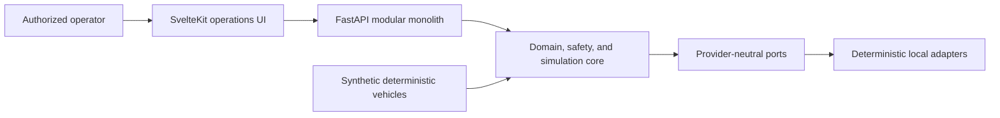
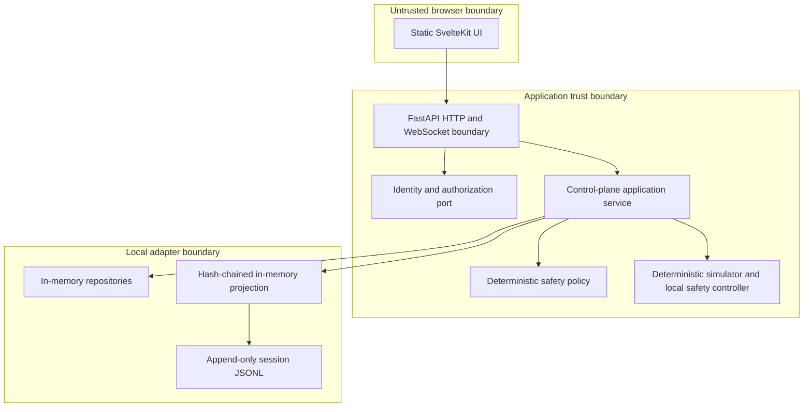
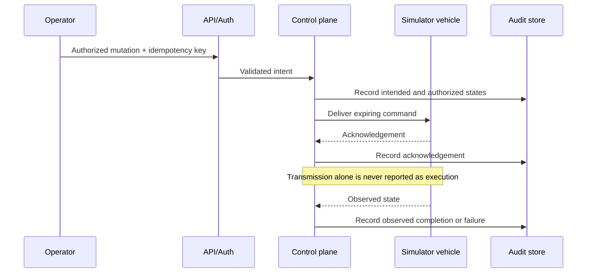

# Treta implemented architecture

This document describes what currently exists. `DESIGN.md` is authoritative for intended design.

## Context

Treta is currently a local, simulation-only system. There is no physical vehicle adapter and no cloud dependency in a flight-control loop.

## Containers

## Component boundaries

- **Domain:** typed drones, capabilities, missions, commands, telemetry, incidents, decisions, and explicit state transitions.
- **Safety:** deterministic and explainable eligibility and landing-reserve rules.
- **Simulation:** seeded clock-driven vehicle state, telemetry, failures, local fallback, recording, and replay. It never uses wall-clock sleeps as simulation state.
- **Application:** use-case orchestration, idempotency, event recording, and port coordination.
- **Ports/adapters:** identity, repositories, event storage, and simulation backends have explicit interfaces. The control plane accepts an injected `FleetSimulatorPort` and defaults to `DeterministicFleetSimulator`. The default API uses a write-through JSONL event adapter; tests and deterministic replay use its in-memory port implementation.
- **Simulation boundary:** `FleetSimulatorPort` is simulation-only; it is not a MAVLink/PX4/ArduPilot vehicle adapter. Built-in deterministic replay is not claimed for injected backends. See ADR 0003.
- **API/UI:** validate untrusted input and display source, freshness, decisions, state, and incidents.

## Command flow

## Telemetry and safety flow

Synthetic vehicle telemetry is sequence-checked and projected in memory for the UI. The simulator's local safety controller evaluates landing reserve at each deterministic tick. It can transition the simulated vehicle to returning or landing without any cloud/API round trip; the control plane observes and audits that response. Every default local API session writes canonical events synchronously to a uniquely named `.treta/events/*.jsonl` file and fails the application action if the durable write fails.

## State ownership

| State | Current owner | Planned adapter |
| --- | --- | --- |
| Vehicle dynamics and local fallback | Deterministic simulator | Physical vehicle or trusted-edge adapter |
| Mission and command lifecycle | Application domain | Firestore-compatible repository |
| Current telemetry projection | In-memory adapter | Low-rate Firestore projection |
| High-rate telemetry | Simulator recorder | Compressed object-storage segments |
| Audit events | In-memory query projection plus per-session JSONL write-through | Transactional outbox, signed checkpoints, and durable event/object store |

## Trust boundaries and scaling path

External HTTP/WebSocket input is untrusted. Identity claims are converted to an internal principal; authorization remains server-side. Tenant identifiers are scoped at the application boundary. The local identity adapter is development-only.

The JSONL adapter makes local evidence survive process exit, but it is not an immutable store and is not loaded to reconstruct entity projections after restart. This limitation is explicit; no production durability or tamper-proof claim is made.

Scaling replaces adapters without changing domain rules: local identity to OIDC/Firebase, repositories to Firestore or another document store, event bus to NATS, object storage to MinIO/R2/S3, and regional telemetry ingestion to a separately justified pipeline. Global-cloud latency never becomes a vehicle stability dependency.
